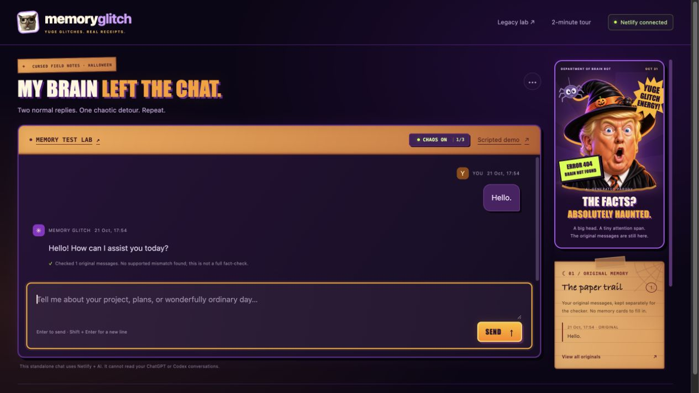

# Memory Glitch

**An AI chat with a Halloween sense of humor—and receipts when it loses the plot.**

[Try the live chat](https://extraordinary-croissant-b36d78.netlify.app/memory-glitch/) · [Run the real memory test](https://extraordinary-croissant-b36d78.netlify.app/memory-glitch/tests) · [Browse verification records](docs/verification/)



## The need, the twist, the value

In a long project conversation, an AI can contradict an earlier decision or fail to recover a detail you already supplied. Students and developers need a way to notice the discrepancy, inspect the evidence, and continue working.

Memory Glitch turns that frustrating moment into a Halloween meme **with the original quote and a useful correction attached**. The joke gets your attention; the receipt helps you decide what to restore. You can keep chatting throughout.

Two mechanisms remain deliberately separate:

- **Memory alerts:** a supported contradiction or missed recall triggers an immediate alert, quoted evidence, and a context-restoration action.
- **Chaos reactions:** two normal replies, then one playful reply with a cat image or Trump GIF; the cycle repeats. These are explicitly labelled **“CHAT REACTION / NOT A MEMORY ALERT.”** They do not imply that the AI forgot anything.

## Try it in two minutes

1. Open the [chat](https://extraordinary-croissant-b36d78.netlify.app/memory-glitch/) and tell it a project name and budget. Ask follow-ups. With Chaos on, replies 1 and 2 stay ordinary; reply 3 adds a reaction. The counter survives a reload.
2. Choose **Scripted demo** to exercise a known contradiction or missed-recall case. The sample reply is fixed and labelled; the checker runs live. A correct demo reply should not produce a memory alert.
3. Open **Memory Test Lab** and run three actual model calls. It sends 20, 10, then 0 facts while asking the same 20 questions. Expand the answers and request receipts, or export the JSON.

Normal chat does not deliberately manufacture factual errors. A real memory alert may therefore take longer to encounter than a scheduled Chaos reaction. Turning Chaos off stops ordinary reaction memes; evidence-backed alerts remain enabled.

## How it works

The frontend is plain HTML, CSS, and JavaScript. The backend uses **Netlify Functions, Netlify Blobs, and Netlify AI Gateway**; the model is currently `gpt-4.1-mini`.

| Function / route | Responsibility |
| --- | --- |
| [`memory-chat.mjs`](netlify/functions/memory-chat.mjs) · `/api/memory-chat` | Real conversation, context selection, consistency checks, Chaos cadence, labelled demo, evidence restoration, and feedback. |
| [`memory-glitch.mjs`](netlify/functions/memory-glitch.mjs) · `/api/memory-glitch` | Controlled recall experiments and the preserved legacy memory lab. |

For normal chat, the context builder selects recent conversation with a 16,000-character target and prioritizes explicitly restored statements. The checker separately receives historical user statements, with its own 60,000-character coverage limit. Candidate findings must contain exact source/reply substrings, pass code validation, and survive a second model review before becoming an alert. The UI exposes context inclusion and coverage instead of treating the visible transcript as proof of what the model received.

Netlify Blobs stores originals, replies, annotations, experiment results, revisions, and the Chaos counter. Separate browser-session cookies identify the chat and experiment stores. Conditional writes prevent silently overwriting concurrent updates. Confirmed incorrect assistant replies and separate meme-caption fields are excluded from subsequent conversation context.

The experiment removes fields **in code before the request is sent**. It does not ask a model to pretend to forget. Tests use a separate synthetic fixture, not the visitor's conversation. `Unknown` means abstention; `Mismatch` means an answer differs from the reference and needs review.

## Verification

The repository includes **62 automated tests** covering context selection, quote validation, updated facts, conservative review, reactions, cadence, and experiment isolation, alongside preserved game tests.

```sh
node --test tests/*.test.mjs
# Equivalent: pnpm test
```

A recorded live experiment produced:

| Facts supplied | Correct | Unknown | Mismatch |
| ---: | ---: | ---: | ---: |
| 20 / 20 | 20 | 0 | 0 |
| 10 / 20 | 10 | 10 | 0 |
| 0 / 20 | 0 | 20 | 0 |

See the [full experiment and actual request inputs](docs/verification/forgetting-test-results.json), [six-turn cadence and reload checks](docs/verification/cadence-live-qa.json), and [backend deployment smoke test](docs/verification/backend-deployment-qa.json). These are recorded runs, not prefilled live UI scores. One synthetic experiment is not an accuracy benchmark or a measurement of model memory capacity.

## Run your own instance

Use **Node.js 22.12.0 or newer** and pnpm. The locked `@netlify/blobs@11.1.4` dependency requires that Node version.

```sh
pnpm install --frozen-lockfile
npx netlify login
npx netlify link
```

Link to **your own Netlify site**. Configure Netlify AI Gateway for that site so the Functions environment receives `OPENAI_API_KEY` and `OPENAI_BASE_URL`, with access to the configured model. Cloning this repository does not provision a gateway, credits, or access to the hosted application's backend. Keep credentials in Netlify environment configuration or an ignored local `.env` file, never in frontend code.

```sh
npx netlify dev
```

Open the local URL printed by the CLI, followed by `/memory-glitch/`. The real chat and tests require working Functions, Blobs, and gateway configuration. `pnpm start` is only a static preview using Python 3; it does not provide the AI backend.

For deployment, import the repository into Netlify. [`netlify.toml`](netlify.toml) publishes the checked-in `dist/` directory and bundles `netlify/functions/` with esbuild; no frontend build step is required. Configure the gateway on the destination site before testing its AI routes.

## Scope and limits

- This is a standalone chat, not a browser extension. It cannot read ChatGPT or Codex conversations or inspect a model's internal memory.
- The detector checks consistency with user statements, not whether those statements are externally true. It can miss issues or flag them incorrectly. A clear result is not a full fact-check.
- Withheld information, an unknown answer, and hallucination are different outcomes. No automatic claim of “internal forgetting” is made.
- Conversations and originals are stored in Netlify Blobs and sent to the configured model service for replies/checks. Sessions are browser-specific; there is no cross-device account system.
- This is a hackathon prototype. Gateway availability, limits, and configuration affect live tests; failed calls are not converted into fabricated scores.

## Repository and assets

The main application is in [`dist/memory-glitch/`](dist/memory-glitch/). The earlier **Trick Town** game remains at `/`, and its documentation is preserved in [`docs/legacy-trick-town.md`](docs/legacy-trick-town.md). The advanced legacy memory interface remains at `/memory-glitch-lab/`.

The UI uses eight cat images and five animated Trump reaction GIFs. Provenance is recorded in [`cat-sources.json`](dist/memory-glitch/assets/cat-sources.json) and [`trump-sources.json`](dist/memory-glitch/assets/trump-sources.json). The witch portrait is labelled AI-generated parody. Additional meme captions are fictional comedy, not quotations from the pictured person. Third-party images, GIFs, and bundled libraries retain their respective rights; this repository does not claim ownership or grant a blanket license over them.

## Nailoong game remake

The original Nailoong model now stars in **Midnight Munchies**, a separate playable Halloween game. Visit three houses, collect 12 candies, laugh ghosts into giving up sweets, and escape before midnight. It has follow/overview cameras, keyboard and click navigation, phone controls, and safe doorsteps.

[Play Midnight Munchies](https://extraordinary-croissant-b36d78.netlify.app/nailoong-night/) · [Game source and controls](dist/nailoong-night/README.md) · [Verification record](docs/verification/nailoong-night-qa.json)

The game reuses the existing GLB with its original idle/laugh clips and new Halloween accessories. Its score is stored locally; it does not call the Memory Glitch AI backend.
